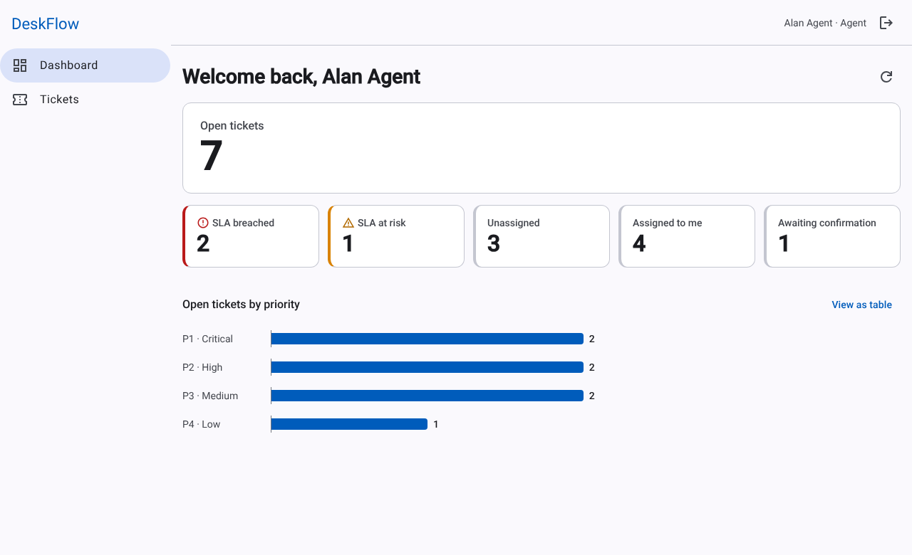
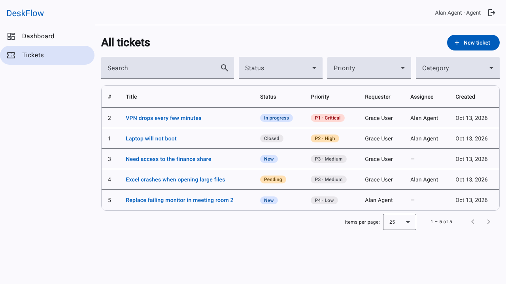
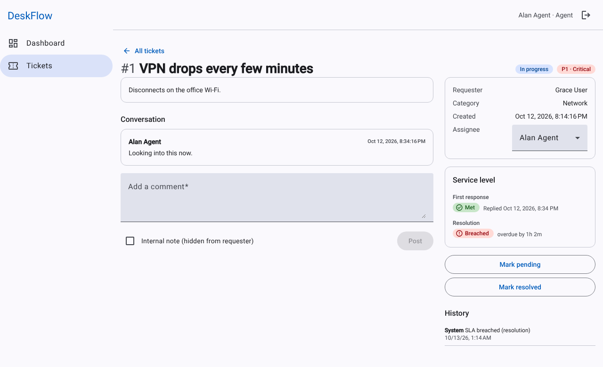
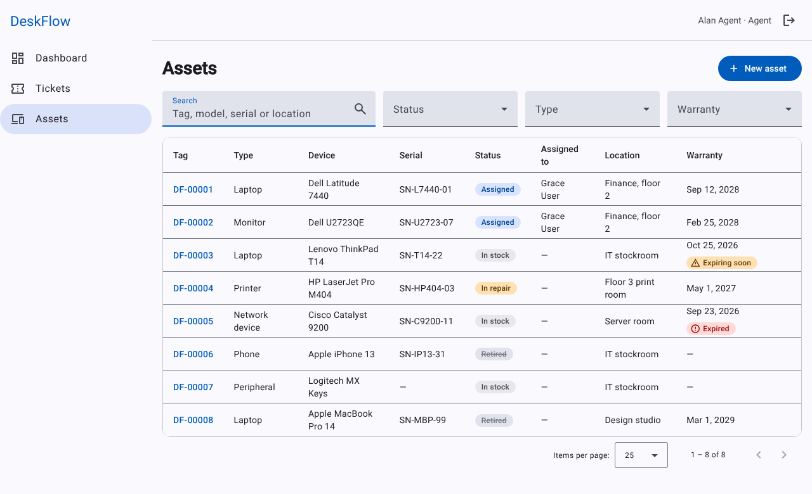
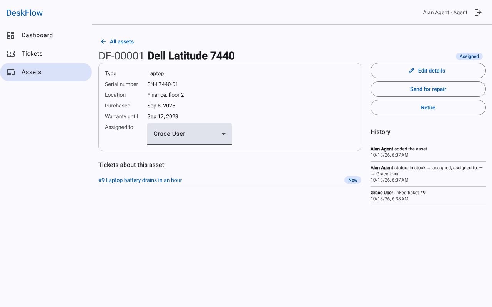
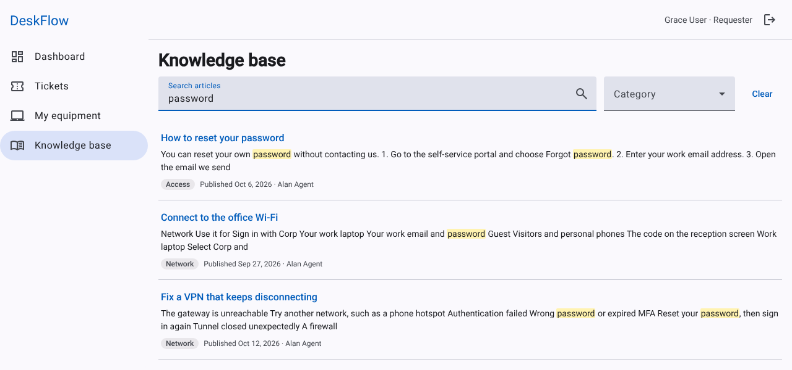
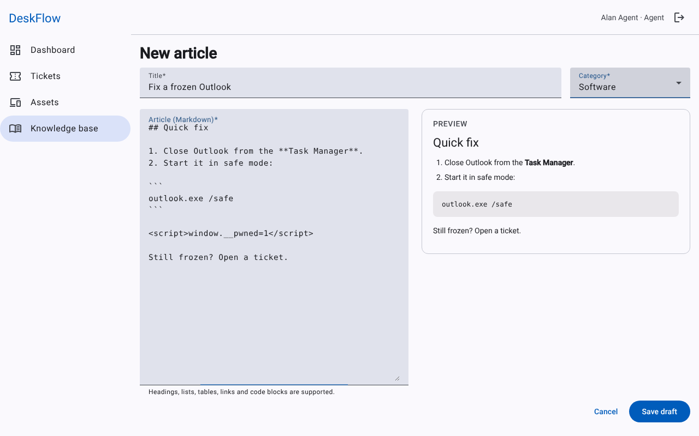
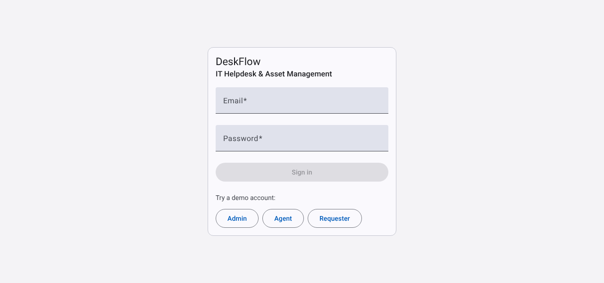
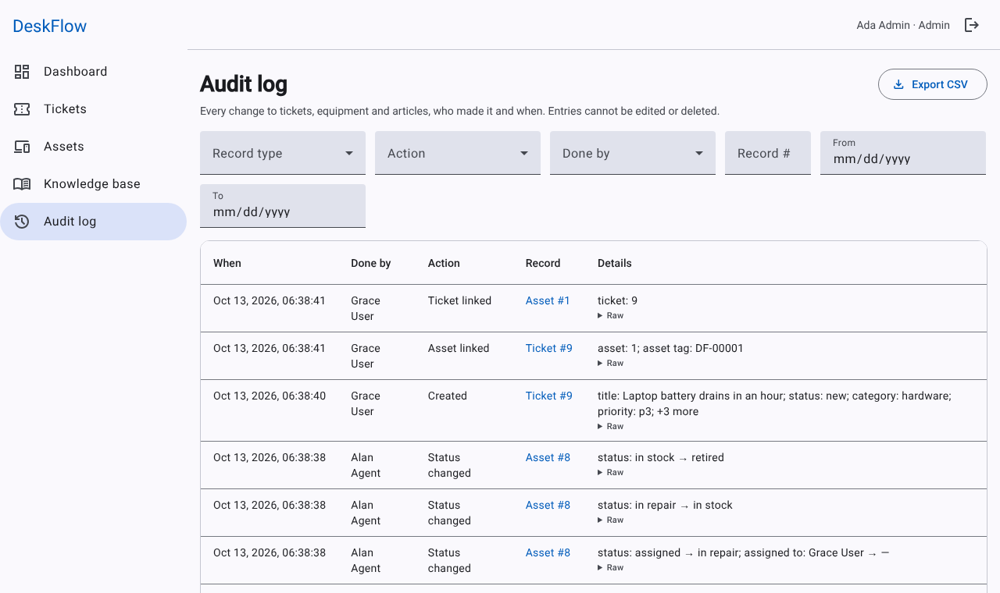
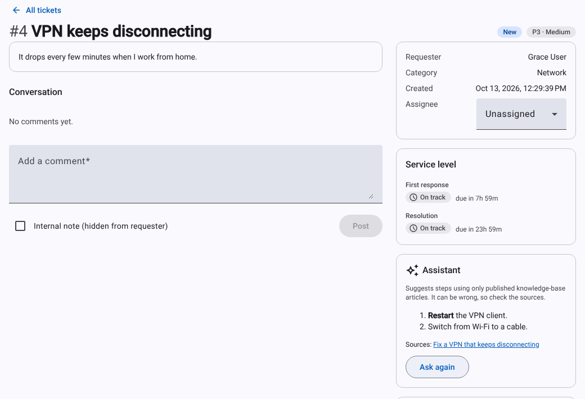

# DeskFlow

**IT helpdesk and asset management platform**: a small service desk inspired by tools like ServiceNow.

[](https://github.com/sam-razavi/deskflow/actions/workflows/ci.yml)

Built with **Angular 22**, **FastAPI**, **PostgreSQL** and **Redis**, containerised with Docker and deployed on Railway.

<p>
  
  
  
</p>
<p>
  
  
</p>
<p>
  
  
</p>
<p>
  
  
  
</p>

## Features

| Module | Status |
|---|---|
| Authentication: JWT access and refresh tokens, role-based access (Requester / Agent / Admin) | ✅ |
| Tickets: status workflow, priorities P1–P4, categories, comments with staff-only internal notes, assignment, search, filters and pagination | ✅ |
| SLA timers: response and resolution targets per priority, clock paused while a ticket is Pending, a background worker that flags tickets at risk or breached | ✅ |
| Audit log: append-only record of every ticket, asset and article change (who, what, when, before/after), shown as a history on each record and in an admin screen with filters (record type, action, person, record number, dates) and a CSV export | ✅ |
| Hardware inventory: generated asset tags, lifecycle status (in stock / assigned / in repair / retired), assignment to users, warranty tracking, ticket links, per-asset history. Requesters get a read-only "My equipment" view | ✅ |
| Knowledge base: Markdown articles with a draft/published workflow, Postgres full-text search (ranking, stemming, phrases, highlighted snippets), a live-preview editor, and article suggestions while a ticket is being written | ✅ |
| AI troubleshooting assistant (optional, staff only): suggests steps for a ticket using only published knowledge-base articles, always shows which articles it relied on, and says so when they don't cover the problem | ✅ (see below) |
| Dashboard: open tickets, SLA breached / at risk, unassigned, my queue, assets in repair, warranties expiring, and a priority chart, with each figure linking to the matching ticket or asset list | ✅ |

**Planned (phase 2):** email notifications, CSV asset import/export, attachments.

## How tickets work

- **Workflow:** `New → In progress ⇄ Pending → Resolved → Closed`. Resolved tickets can be reopened, and Closed is final. Invalid moves are rejected with `409`. The rules live in one place, `backend/app/services/workflow.py`.
- **Roles:** requesters see and edit only their own tickets (and only while still New), can add comments, and can confirm or reopen a resolved ticket. Agents and admins see everything, change priority, assign tickets and write internal notes. Another user's ticket returns `404`, not `403`, so ids can't be probed.
- **Assignment:** only agents and admins can be assignees. Assigning a New ticket moves it to In progress.
- **SLA:** each priority has a response and a resolution target, stored as deadlines on the ticket.

  | Priority | First response | Resolution |
  |---|---|---|
  | P1 · Critical | 1 h | 4 h |
  | P2 · High | 4 h | 8 h |
  | P3 · Medium | 8 h | 24 h |
  | P4 · Low | 24 h | 72 h |

  The first public reply from staff (not an internal note, and not the requester) stops the response clock. Moving a ticket to **Pending** pauses both clocks, and when it leaves Pending the deadlines move back by the time spent waiting. A ticket is *at risk* once 75% of its resolution window has passed and *breached* when a deadline passes. Times are wall-clock, not business hours. Requesters don't see SLA information.
- **One source of truth:** `backend/app/services/sla.py` decides every SLA state. The API, the dashboard, the list filter and the worker all call it, so they can't disagree.
- **Inventory:** assets get a generated tag (`DF-00042`, from a database sequence so it is safe under concurrency) unless you supply one. Status is *in stock*, *assigned*, *in repair* or *retired*:
  - Assigning is the only way into *assigned* and unassigning the only way out, so an assignee can never be left behind. A database constraint enforces that an asset is assigned exactly when it has an assignee.
  - Sending an assigned asset for repair or retiring it takes it back from the user. *Retired* is final.
  - Tag and serial number are unique. Warranties show *expiring soon* within 30 days, and retired equipment drops out of warranty reminders.
  - Staff manage everything. Requesters see only equipment assigned to them, and can link their own equipment to their own tickets. Tickets and assets link both ways and each link is audited on both records.
- **Knowledge base:** staff write articles in Markdown, as drafts first, and publish them for everyone. Requesters only ever see published articles; to them a draft doesn't exist.
  - **Search** is Postgres full-text search over a generated `tsvector` column with a GIN index. Titles outrank body text, word forms match (`printers` finds `printer`), and it understands `"exact phrases"` and `-exclusions`. Odd input never errors, because queries are built with `websearch_to_tsquery`.
  - **Snippets** show the matching part of the article as plain text with the matched words highlighted. The API marks matches with private delimiter characters rather than HTML, so the client never has to trust markup coming from the database.
- **Troubleshooting assistant:** off until `ANTHROPIC_API_KEY` is set. An agent presses "Suggest steps" on a ticket (it never runs by itself, because each run costs money).
  - **Grounded:** the articles are found with the same search as the suggestions above (published only, at most four) and are the only knowledge the model is given. If none match, the model is not called at all. The model must list the articles it used; ids it invented are dropped, and an answer citing nothing it was given is discarded and shown as "not covered".
  - **Untrusted input:** ticket and article text are passed as delimited data with an instruction not to follow anything inside them. That reduces prompt injection but cannot eliminate it, so the output is rendered through the same sanitised Markdown path as articles, and it is advice for a human to check, never an action.
  - **Limits and audit:** 20 requests per person per hour by default (every attempt counts, in Redis), a 502 if the model is unreachable, and an audit entry per run recording the model and which articles were retrieved and cited. The generated text itself is not stored.
  - **Not verified:** the request shape is tested against the real SDK with a local fake server, and the logic with a fake client, but answer quality has not been checked against the live model.
  - **Suggestions** (`/api/articles/suggest`) power the "These articles might help" box on the new-ticket form and the staff view of a ticket. Articles containing every word of the title come first. Only when there are none does it fall back to articles containing any word, dropping ones that are much weaker than the best.
  - **Safe rendering:** article Markdown is rendered with `marked` and bound through Angular's HTML sanitiser, which removes scripts, event handlers and `javascript:` links. Tests cover hostile content.
  - Staff can delete drafts. Deleting a published article is admin-only. Every change is audited.
- **Audit log screen (admins):** filter by record type, action, person, record number and date range, expand any entry to its raw JSON, and export the filtered result as CSV. Entries are only ever inserted, never edited or deleted, and they outlive their records: an entry about a record that has since been deleted is shown as plain text marked "deleted" instead of a link. The export is capped at 10,000 rows and neutralises spreadsheet formulas (a name like `=HYPERLINK(...)` is written as text), so opening it in Excel cannot run anything.
- **Audit trail:** every write records who did it and the before/after values in the same database transaction as the change, so a rolled-back request leaves no trace.

## Architecture

```
            ┌──────────────────────┐        ┌──────────────────┐
 Browser ──▶│ web (nginx + Angular)│──/api─▶│ api (FastAPI)    │──┐
            └──────────────────────┘        └──────────────────┘  ├──▶ PostgreSQL
                                            ┌──────────────────┐  │
                                            │ worker (arq)     │──┤
                                            │ SLA check, 1/min │──┴──▶ Redis
                                            └──────────────────┘
```

- **Same-origin API.** nginx serves the Angular build and reverse-proxies `/api` to the backend, so production needs no CORS. In development, `ng serve` does the same with `proxy.conf.json`.
- **Async all the way down.** SQLAlchemy 2.0 async with asyncpg, and Alembic migrations that run automatically on deploy.
- **Real-database tests.** Backend tests run against PostgreSQL (not SQLite). Each test runs in a transaction that is rolled back afterwards.

### Tech choices

| Area | Choice |
|---|---|
| Frontend | Angular 22 (standalone components, signals, built-in control flow, functional guards and interceptors), Angular Material 3, marked (Markdown), Vitest |
| Backend | FastAPI, SQLAlchemy 2.0 (async), Pydantic v2, Alembic, PyJWT, Argon2 password hashing |
| Data | PostgreSQL 16, Redis 7 (background jobs and sign-in rate limiting) |
| Tooling | uv, Ruff, mypy (strict), pytest, Prettier, GitHub Actions, Docker Compose |

## Getting started

### Everything in Docker

```bash
docker compose up --build
```

Open http://localhost:4200. API docs (Swagger) are at http://localhost:8000/docs.

### Local development

Requirements: Python 3.12+, [uv](https://docs.astral.sh/uv/), Node 22.22.3+ (or 24), and Docker for Postgres and Redis.

```bash
docker compose up -d db redis

# Backend
cd backend
cp .env.example .env
uv sync
uv run alembic upgrade head
uv run python -m app.seed
uv run uvicorn app.main:app --reload

# Background worker for SLA monitoring (needs Redis; optional for local development)
uv run arq app.worker.WorkerSettings

# Frontend (another terminal)
cd frontend
npm install
npm start          # http://localhost:4200, proxies /api to :8000
```

### Demo accounts

All demo accounts use the password `deskflow123`. The seed (`python -m app.seed`, idempotent) also fills a fresh install with a lived-in helpdesk:

- **Knowledge base:** sample articles, and one draft.
- **Tickets:** 20 from a handful of colleagues (who can't sign in), across every category, priority and status. Some are new and unassigned, some are in Alan Agent's queue, two wait on the requester with the SLA clock paused, two are at risk, two have breached, and the rest are resolved or closed, with replies and internal notes. Grace User has three of her own.
- **Equipment:** 15 items, assigned, in stock, in repair and retired, linked to the tickets about them. Two warranties run out this month.
- **History:** it is replayed through the app's own rules rather than inserted as finished rows: SLA deadlines, the workflow, asset tags, an audit entry for every change at the time it happened, and the SLA monitor once a minute, so the seeded at-risk and breach flags are exactly what the worker would have recorded. Times are relative to when it runs.
- Tickets and equipment are only added to an empty helpdesk, so sample records never mix with real ones.

**Daily reset (public demo).** SLA timers are wall-clock, so a demo seeded once is all breached within days, and visitors change things. When `SEED_DEMO_DATA=true` is set on the worker, it recreates the demo every day at 03:30 UTC: tickets (with their comments and equipment links), equipment and articles are deleted and seeded again relative to the current time, in one transaction, so visitors never see it half done. Accounts are kept. The audit log is never touched: the old records' history stays, the new records' history is added to it, and the reset itself is logged with what it removed and created. Ids and asset tags are never reused, so an old entry can't come to describe a new record. It never runs by default, not even in development, and it refuses unless the documented demo accounts exist.

| Role | Email |
|---|---|
| Admin | admin@deskflow.dev |
| Agent | agent@deskflow.dev |
| Requester | user@deskflow.dev |

## Testing

```bash
# Backend (needs Postgres; uses the deskflow_test database)
cd backend
uv run pytest
uv run ruff check . && uv run mypy app

# Frontend
cd frontend
npx ng test --watch=false
```

## Deployment (Railway)

> **What has and hasn't been verified.** The three container images were built and run together with
> Docker Compose exactly as they run in production: migrations, the worker, nginx, security headers,
> production-mode start-up and the first-admin bootstrap, with every page exercised in a browser.
> The Railway steps below follow Railway's documentation as of October 2026 but have **not** been run
> against a live Railway project, so check them against your dashboard the first time.

The repository deliberately contains **no `railway.json`**. Railway's *Config as Code* files are
deprecated and stop being read on 2026-12-01 ([Railway docs](https://docs.railway.com/infrastructure-as-code)),
and Railway builds with a `Dockerfile` automatically when it finds one. Everything a service needs is
therefore a **root directory** and a few **variables**, set once in the dashboard. The same image runs
as either the API or the worker, chosen by `SERVICE_ROLE`, so no custom start command is needed.

Create a project with five services, all deployed from this repository:

| Service | Root directory | Variables |
|---|---|---|
| **Postgres** | (database template) | |
| **Redis** | (database template) | |
| **api** | `/backend` | `ENVIRONMENT=production`<br>`JWT_SECRET` (at least 32 characters: `openssl rand -hex 32`)<br>`DATABASE_URL=${{Postgres.DATABASE_URL}}`<br>`REDIS_URL=${{Redis.REDIS_URL}}`<br>`PORT=8000`<br>`ADMIN_EMAIL`, `ADMIN_PASSWORD` (see below) |
| **worker** | `/backend` | `SERVICE_ROLE=worker`<br>`ENVIRONMENT=production`<br>`JWT_SECRET=${{api.JWT_SECRET}}`<br>`DATABASE_URL`, `REDIS_URL` as for the api<br>`SEED_DEMO_DATA=true` only for a public demo (daily reset) |
| **web** | `/frontend` | `API_UPSTREAM=http://${{api.RAILWAY_PRIVATE_DOMAIN}}:8000` |

Then in the dashboard:

- **api** → Settings → set the *Healthcheck Path* to `/api/health`. It needs no public domain.
- **web** → Networking → *Generate Domain*. nginx listens on `PORT` (default 80): if Railway asks for a
  target port, enter `80`, or set `PORT` explicitly. This is the only public service.
- **worker** needs no domain and no health check. Deploy the api first: it owns migrations.

What the containers do on every deploy, which you can rely on:

- The **api** applies database migrations before serving. If a migration fails, the container exits and
  the previous release keeps running. It then creates the first administrator if `ADMIN_EMAIL` and
  `ADMIN_PASSWORD` are both set (at least 12 characters; an existing account is never changed, so the
  variable cannot take over or promote a user). Set both, deploy once, sign in, and you can remove
  `ADMIN_PASSWORD`.
- **Demo accounts are off in production.** They have publicly documented passwords, so they are only
  created in production if you set `SEED_DEMO_DATA=true`. For a public portfolio demo that is the point,
  but never do it for real data. Set it on the **api** to seed the demo on deploy, and on the **worker** as
  well to reset it daily (the reset deletes and recreates tickets, equipment and articles; the audit log
  only grows).
- The app **refuses to start in production** with the built-in development secret or one shorter than
  32 characters, and rejected secrets are not written to the logs.
- Sign-in is **rate limited** through Redis: five wrong passwords per person and address, and 30 per
  address, within 15 minutes. If Redis is down the limit is skipped rather than blocking everyone.
- The API and worker run as a non-root user with read-only code. The web container sends a strict
  Content-Security-Policy (the one inline script is allowed by hash, computed at build time), plus
  `X-Content-Type-Options`, `X-Frame-Options`, `Referrer-Policy` and `Permissions-Policy` headers.

Notes:

- **Private networking.** Environments created after 16 October 2025 resolve private names over IPv4
  and IPv6, so the default `0.0.0.0` works. In an older, IPv6-only environment set `HOST=::` on the api.
  The web container only listens on IPv6 when the platform provides it, so it starts anywhere.
- **Fonts.** The interface loads Roboto and the icon font from Google Fonts, and the CSP allows exactly
  those hosts. To remove that third-party dependency, self-host the fonts and drop the two hosts from
  `frontend/nginx.conf.template`.
- **Optional.** Railway's replacement for config files is a TypeScript `.railway/railway.ts`
  (`railway config init`). It is not included, because its Dockerfile, root-directory and port syntax
  was not in the documentation I could read and I would rather not ship configuration I can't verify.

### Environment variables

| Variable | Used by | Default | Purpose |
|---|---|---|---|
| `ENVIRONMENT` | api, worker | `development` | `production` turns on the secret checks and stops demo seeding |
| `JWT_SECRET` | api, worker | dev only | Signs tokens. Required in production |
| `DATABASE_URL` | api, worker | local Postgres | `postgres://` and `postgresql://` are converted for the async driver |
| `REDIS_URL` | api, worker | local Redis | Background jobs and sign-in rate limiting |
| `SERVICE_ROLE` | api, worker | `api` | `worker` runs the background worker instead of the web server |
| `PORT`, `HOST` | api | `8000`, `0.0.0.0` | Listen port and address |
| `ADMIN_EMAIL`, `ADMIN_PASSWORD`, `ADMIN_NAME` | api | none | Creates the first admin if missing |
| `SEED_DEMO_DATA` | api, worker | `true` in development, `false` in production | Demo users, articles, tickets and equipment. On the worker, an explicit `true` also resets the demo daily |
| `ANTHROPIC_API_KEY` | api | none (assistant disabled) | Enables the troubleshooting assistant |
| `ASSISTANT_MODEL`, `ASSISTANT_EFFORT` | api | `claude-opus-5-5`, `medium` | Model and reasoning effort; a cheaper model is a fine choice here |
| `ASSISTANT_MAX_REQUESTS`, `ASSISTANT_WINDOW_SECONDS` | api | `20`, `3600` | Per-person usage limit |
| `CORS_ORIGINS` | api | `["http://localhost:4200"]` | Only needed if the API is called from another origin |
| `API_UPSTREAM`, `PORT` | web | `http://api:8000`, `80` | Where nginx proxies `/api`, and its listen port |

## Project structure

```
backend/
  app/
    api/         routes and dependencies (auth, role checks)
    core/        settings, database, security
    models/      SQLAlchemy models (users, tickets, comments, assets, articles, audit logs)
    schemas/     Pydantic request and response models
    services/    business rules (ticket and asset workflows, SLA, search, audit recording)
  alembic/       migrations
  tests/
frontend/
  src/app/
    core/        auth, ticket and user API services, interceptor, guards
    layout/      app shell (sidenav and toolbar)
    features/    one folder per feature (login, dashboard, tickets, assets, kb)
```
